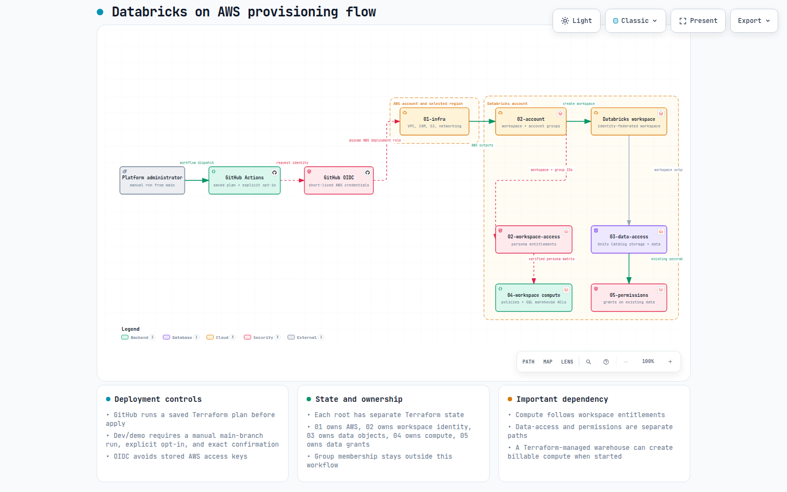
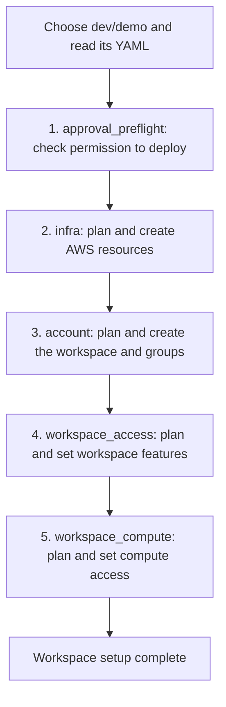
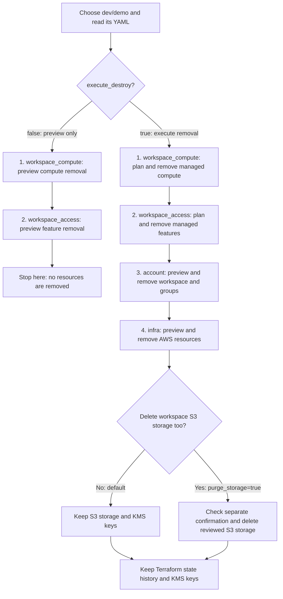

# Databricks on AWS foundation

This folder contains Terraform and configuration for a Databricks workspace on
AWS. It creates the AWS network and storage, creates the Databricks workspace,
and can configure governed data access and compute.

Start with the platform configuration, not Terraform files. The configuration is
designed to make it clear which team owns each decision and which Terraform root
will apply it.

## Contents

- [Architecture overview](#architecture-overview)
- [Before you start](#before-you-start)
- [Quick start for a new development workspace](#quick-start-for-a-new-development-workspace)
- [How the repository is organized](#how-the-repository-is-organized)
- [What runs, and in what order](#what-runs-and-in-what-order)
- [Access, data, and compute](#access-data-and-compute)
- [GitHub Actions and safe deployment](#github-actions-and-safe-deployment)
- [Provisioning YAML flow](#provisioning-yaml-flow)
- [Changing an existing workspace](#changing-an-existing-workspace)
- [Deprovisioning](#deprovisioning)
- [Deprovisioning YAML flow](#deprovisioning-yaml-flow)
- [Validation](#validation)
- [Reference](#reference)

## Architecture overview

The diagram shows the normal provisioning path. A platform administrator starts
a manual GitHub Actions run from `main`. GitHub exchanges its OIDC identity for
short-lived AWS credentials, then Terraform builds the AWS foundation and creates
the Databricks workspace. Workspace entitlements, data access, compute, and data
permissions are separate follow-up roots with their own state and ownership.

[](docs/diagrams/provisioning-architecture.html)

Open the image for the interactive diagram. The editable
[diagram specification](docs/diagrams/provisioning-architecture.json) documents
the exact components and relationships.

## Before you start

You need:

- An AWS account, a supported AWS region, and an S3 bucket for Terraform state.
- A Databricks account with permission to create a workspace.
- OAuth machine-to-machine credentials or workload identity federation for
  Terraform. Do not use or commit personal access tokens.
- Permission to configure the GitHub Environments used by the workflow.

Terraform state can contain resource identifiers and other sensitive metadata.
Keep state, AWS credentials, client secrets, and local `.tfvars` files with
secrets out of Git.

### Supported AWS regions

Choose a Databricks-supported AWS region before creating infrastructure. This
list was checked on 2026-10-08; confirm current support in the official
[Databricks region list](https://docs.databricks.com/aws/en/resources/supported-regions)
and [feature availability guide](https://docs.databricks.com/aws/en/resources/feature-region-support).

| Geography | AWS region IDs |
| --- | --- |
| Asia Pacific | `ap-northeast-1`, `ap-northeast-2`, `ap-south-1`, `ap-southeast-1`, `ap-southeast-2`, `ap-southeast-3` |
| Canada | `ca-central-1` |
| Europe | `eu-central-1`, `eu-west-1`, `eu-west-2`, `eu-west-3` |
| South America | `sa-east-1` |
| United States | `us-east-1`, `us-east-2`, `us-west-1`, `us-west-2` |
| AWS GovCloud (US) | `us-gov-west-1` |

`eu-north-1` is not currently supported. For a European deployment,
`eu-central-1` is a supported choice. The workspace region comes from
`01-infra`; changing only `02-account` does not move a workspace.

## Quick start for a new development workspace

1. Read [the platform guide](platform/README.md). It explains the YAML files
   that define an environment, access personas, and approved compute.
2. Start from the dev/demo configuration under `platform/`. Choose a unique
   environment and workspace name. The pair is the workspace identity.
3. Set GitHub Environment variables and secrets. The
   [environment adapter guide](tools/environment/README.md) explains the
   required values and setup.
4. Run the provisioning workflow manually from `main`. Review the plan before
   selecting the explicit apply option.
5. After provisioning, verify access with one test user per persona before
   onboarding a wider group.

For a new dev/demo workspace, provisioning runs:

```text
01-infra → 02-account → 02-workspace-access → 04-workspace compute
```

This creates no running cluster. A SQL warehouse can incur Databricks charges
when it is started, so review its configuration and permissions carefully.

## How the repository is organized

```text
platform/                  Administrator-owned inputs
  environments/            Workspace and AWS provisioning YAML
  access/                  Personas, groups, resources, and reviewer routing
  compute/                 Approved cluster-policy and SQL-warehouse definitions
  terraform-inputs/        Optional JSON inputs; no Terraform code or state
workloads/                 Team requests for approved persona and data access
environments/              Terraform execution roots
modules/aws/               Reusable AWS Terraform modules
modules/databricks/        Reusable Databricks Terraform modules
tools/environment/         YAML validation, rendering, provisioning, teardown
tools/databricks-access/   Access and compute validation and Terraform runners
docs/adr/                  Design decisions and ownership rules
```

The `platform/` folder is for platform administrators. Teams use
[`workloads/`](workloads/README.md) to request an existing persona and access to
existing data. A workload cannot choose its own compute policy or SQL warehouse.

The supplemental files in `platform/terraform-inputs/` add optional Terraform
inputs. They cannot override values owned by environment YAML.

## What runs and in what order

Each root has its own Terraform state and a clear job. Apply a whole root; do
not use `-target` to apply selected resources.

| Root | Owns | Typical examples |
| --- | --- | --- |
| `01-infra` | AWS foundation | VPC, subnets, egress, security groups, endpoints, IAM, S3, optional KMS and monitoring |
| `02-account` | Databricks account and workspace | Account configuration, workspace, account groups, budget alerts |
| `02-workspace-access` | Dev/demo workspace entitlements | SQL and workspace access for the bootstrap personas |
| `03-data-access` | Unity Catalog data objects | Metastore assignment, credentials, locations, catalogs, schemas, volumes |
| `04-workspace` | Workspace configuration | Bootstrap identities, instance profiles, cluster policies, SQL warehouses, jobs |
| `05-permissions` | Grants on existing data objects | Catalog, schema, table, and volume grants from workload requests |

The general creation order is:

```text
01-infra → 02-account → 03-data-access → 04-workspace
```

Dev/demo adds `02-workspace-access` after `02-account`. Its compute workflow
can run after that feature state and does not need a metastore or catalog.

The roots deliberately keep account-level and workspace-level Databricks
resources apart. Account resources use the `databricks.accounts` provider;
workspace resources use `databricks.workspace`. This prevents one state from
trying to own both kinds of resource.

## Access, data, and compute

### Personas and data access

The active access model is defined in
[ADR 0006](docs/adr/0006-yaml-terraform-permissions.md). Terraform manages
workspace-specific groups, workspace assignments, entitlements, and grants on
**existing** data objects. It does not create users, group membership, or data
objects through the access workflow.

For dev/demo, `02-account` creates these groups and assignments:

| Group | Workspace role |
| --- | --- |
| `dev-demo-admins` | `ADMIN` |
| `dev-demo-engineers` | `USER` |
| `dev-demo-analysts` | `USER` |
| `dev-demo-ml` | `USER` |

Membership remains external, normally in the identity provider. Permissions are
additive: a direct grant, another group, or workspace-admin access can grant
more than this repository's persona configuration.

### Compute access

Compute definitions live in `platform/compute/`. The dev/demo wiring gives:

| Persona | Compute access |
| --- | --- |
| Admin | Manage the analytics SQL warehouse and workspace-admin policy access |
| Engineer | `CAN_USE` on `engineering-standard` |
| ML | `CAN_USE` on `ml-standard` |
| Analyst | `CAN_USE` on the analytics SQL warehouse only |

Analysts do not receive a cluster-policy grant from this configuration. Cluster
creation and SQL access entitlements are separate from policy and warehouse ACLs.
Other direct permissions or memberships may still grant compute access.

See the [compute guide](tools/databricks-access/COMPUTE.md) for the policy
rules, commands, and ownership boundaries. [ADR 0007](docs/adr/0007-persona-compute-wiring.md)
records the current compute design.

### Data storage, logging, and init scripts

`03-data-access` owns Unity Catalog storage credentials, external locations,
catalogs, schemas, and volumes. `04-workspace` owns compute policies and may
reference a volume created by root 03 for cluster logs or an init script.

Use the detailed guides when enabling these optional features:

- [Data access module](modules/databricks/data-access/README.md)
- [Cluster-policy module](modules/databricks/cluster-policies/README.md)
- [Development root](environments/dev/README.md)

Never manage the same catalog, grant set, compute policy, or init-script file
from two states. Import and migration of existing resources need a reviewed
ownership plan; matching a name does not adopt it.

## GitHub Actions and safe deployment

Pull requests and relevant main-branch pushes run credential-free validation and
mocked Terraform tests. Live planning, diagnostics, and changes are manual.
Run the dev/demo workflows from `main`.

Dev/demo uses a single-administrator deployment policy. An administrator must
start the workflow on `main`, select the explicit apply or destroy option, and
enter the exact `dev/demo` confirmation. Apply and destroy each have their own
environment opt-in. This policy is intentionally limited to dev/demo; other
targets retain protected-environment review requirements.

The workflow uses its saved plan from the same run. It does not apply a new,
unreviewed plan. Full setup and run instructions are in the
[environment adapter guide](tools/environment/README.md#single-admin-devdemo-deployment).

## Provisioning YAML flow

Provisioning means creating or updating the resources for a workspace. Start
[Provision environment YAML](../../.github/workflows/environment-provision.yml)
from the GitHub Actions page. Choose the environment and workspace, such as
`dev` and `demo`. The workflow reads the matching environment YAML from
`platform/environments/`, plus any matching supplemental inputs.

The diagram shows a dev/demo run with `deploy=true`. A job is a group of steps
that GitHub Actions runs. The numbers match the explanations below.



Each resource job first creates a **plan**, which lists the changes Terraform
intends to make. Its **apply** stage carries out that saved plan only when
`deploy=true` and the required checks pass. A failed job stops the later jobs.

With `deploy=false`, the workflow only plans changes and skips the deployment
permission check. Later plans still need resources from earlier layers to exist.
For example, planning workspace features needs an existing workspace and groups.
A plan-only run cannot complete all layers of a brand-new workspace.

### 1. Check deployment permission — `approval_preflight`

1. Download the repository code and prepare Python.
2. Check that the person starting or rerunning the dev/demo deployment is a repository administrator.
3. Check that deployment is enabled and the confirmation says `dev/demo`.
4. Stop before creating resources if these checks fail.

### 2. Prepare AWS resources — `infra`

1. Check that the environment YAML is valid.
2. Sign in to AWS and check that the account and Terraform state location match the selected workspace.
3. Create and save a plan for `01-infra`, including the configured network, storage, IAM, and monitoring resources.
4. Check deployment permission again and apply that saved plan when deployment is enabled.

Terraform **state** is the record of resources Terraform manages. Each layer
keeps a separate state file so it has a clear owner.

### 3. Create the workspace and groups — `account`

1. Read the AWS resource details produced by `01-infra`.
2. Check that those details belong to the selected environment and workspace.
3. Create and save a plan for `02-account`, including the Databricks workspace and configured account groups.
4. Apply the saved plan when deployment is enabled. For dev/demo, this gives the admin group administrator access and the other persona groups user access.

### 4. Set workspace features — `workspace_access`

1. Read the persona settings, such as admins, engineers, analysts, and ML users.
2. Check that the workspace and group IDs match the account layer.
3. Plan which groups can use the workspace, SQL, and compute-creation features.
4. Apply the saved plan when deployment is enabled. This stage does not create users or change group membership.

### 5. Set compute configuration and access — `workspace_compute`

1. Read the approved compute YAML and persona settings.
2. Check the workspace identity, group IDs, workspace features, and available compute options.
3. Plan the cluster policies, SQL warehouses, and group permissions in `04-workspace`.
4. Apply the saved plan when deployment is enabled. Analysts receive their SQL warehouse access, while engineers and ML users receive their configured policy access.

The feature and compute jobs currently run only for dev/demo. Other supported
development and staging targets use the infrastructure and account jobs.
This provisioning workflow does not create Unity Catalog data objects or apply
the separate `05-permissions` data grants. Creating a cluster policy does not
start a cluster; creating a SQL warehouse can start billable compute.

## Changing an existing workspace

Read the root and module README before changing its configuration. Review a
plan for the complete root, especially if the workspace already exists.

- A folder move does not migrate Terraform state or cloud-resource ownership.
- Do not silently import resources just because a name matches.
- Keep group membership external unless a reviewed migration says otherwise.
- Do not mix manual permissions with Terraform-managed authoritative grant or
  ACL sets.
- Apply roots in dependency order, and regenerate plans after changing inputs.

The development root guide explains initialization and backend configuration:
[`environments/dev/README.md`](environments/dev/README.md). For workspace and
environment identity rules, see
[ADR 0004](docs/adr/0004-environment-workspace-isolation.md).

## Deprovisioning

Deprovisioning is manual. The normal destroy order is:

```text
04-workspace → 03-data-access → 02-workspace-access → 02-account → 01-infra
```

Remove jobs, policies, and init-script references before data volumes. Keep the
metastore assignment until Unity Catalog objects are gone. A reused regional
metastore is not deleted.

S3 buckets and KMS keys are retained by default. Permanent storage deletion is
a separate, explicit option with its own matching confirmation, reviewed
inventory, and post-delete verification. Terraform state storage and history
are always preserved.

Follow the [deprovisioning guide](tools/environment/DEPROVISIONING.md); do not
run a live destroy while developing or testing changes.

## Deprovisioning YAML flow

Deprovisioning means removing the resources managed for a workspace. Start
[Deprovision environment YAML](../../.github/workflows/environment-deprovision.yml)
from the GitHub Actions page. Choose the same environment and workspace used
for provisioning. The workflow uses their YAML and Terraform state to identify
the resources it manages.

The diagram shows the two paths for dev/demo. Leave `execute_destroy=false`
to preview removal. Choose `execute_destroy=true` only when you intend to remove
resources and have supplied the required confirmation.



The execution path removes dependent resources first. For example, it removes
managed compute before removing the groups that use it. Each job must succeed
before removal continues. Dev/demo execution checks administrator permission,
the separate destroy opt-in, and the exact `dev/demo` confirmation.

### 1. Remove managed compute — `workspace_compute`

1. Read the compute configuration and check the workspace and Terraform state.
2. Create and save a plan to remove the compute resources managed by the persona runner.
3. With `execute_destroy=false`, save the preview without removing resources.
4. With `execute_destroy=true`, check permission and confirmation, then apply the saved removal plan.

### 2. Remove managed workspace features — `workspace_access`

1. Read the persona feature settings and check the workspace and groups.
2. Create and save a plan to remove the feature settings managed by this layer.
3. In preview mode, save the preview and stop the workflow before the account and infrastructure jobs.
4. In execution mode, check that managed compute has been retired, then apply the saved removal plan.

### 3. Remove the workspace and groups — `account`

1. Check that downstream states no longer manage resources that need the workspace.
2. Prepare a removal preview for `02-account` using a local copy of Terraform state.
3. Save the preview and check that its configuration and state still match before execution.
4. Remove the managed account-layer resources, including the workspace and its configured groups.

### 4. Remove AWS resources and handle storage — `infra`

1. Check that the account layer has been removed and no downstream resources block teardown.
2. Preview removal of `01-infra`. Keep S3 buckets and KMS keys out of the removal plan by default.
3. Back up the state and stop Terraform from managing the retained storage and keys. Those resources still exist in AWS.
4. Remove the remaining managed infrastructure, such as networking and IAM resources.
5. If `purge_storage=true`, check the separate `confirm_purge_storage` value and the reviewed bucket inventory. After teardown succeeds and all six states are empty, delete the reviewed workspace S3 buckets and their contents.
6. Keep the Terraform state bucket, its history, and KMS keys in either case.

Storage deletion is part of the infrastructure job, not a separate job. The
default keeps workspace data. Setting `purge_storage=true` permanently deletes
the reviewed S3 data after the additional checks pass.

The two workspace jobs currently run only for dev/demo. For other supported
development and staging targets, preview mode previews the account layer only;
execution removes the account layer before infrastructure.

This workflow does not automatically remove `03-data-access` objects or
`05-permissions` grants. Retire those separately before workspace teardown.
It also refuses teardown when other managed downstream resources remain.
See the [deprovisioning guide](tools/environment/DEPROVISIONING.md) for the
complete prerequisites and recovery steps.

## Validation

Install the repository hook once from the repository root:

```bash
pre-commit install
```

It checks common file problems on every commit. It runs Terraform formatting and
linting when Terraform changes, the foundation Python tests when configuration
or runner code changes, and `actionlint` when a GitHub Actions workflow changes.
Run all checks on demand with `pre-commit run --all-files`.

Run these checks from this directory before committing Terraform changes:

```bash
terraform fmt -check -recursive .
tflint --recursive
python3 -m unittest discover -s tools/environment/tests -v
python3 -m unittest discover -s tools/databricks-access/tests -v
```

After changing a Terraform module, run the checks from that module directory:

```bash
terraform init -backend=false
terraform test
terraform fmt -check -recursive .
git diff --check
```

Use a reviewed `terraform plan` for each root before a live apply. Never commit
`.terraform/`, `.tfstate`, or credentials.

## Reference

| Topic | Where to read more |
| --- | --- |
| Platform YAML, ownership, and inputs | [platform guide](platform/README.md) |
| Environment validation, setup, and manual workflows | [environment adapter guide](tools/environment/README.md) |
| Deprovision and optional storage purge | [deprovisioning guide](tools/environment/DEPROVISIONING.md) |
| Persona and data permissions | [access runner guide](tools/databricks-access/README.md) and [ADR 0006](docs/adr/0006-yaml-terraform-permissions.md) |
| Persona compute policies and warehouses | [compute guide](tools/databricks-access/COMPUTE.md) and [ADR 0007](docs/adr/0007-persona-compute-wiring.md) |
| Terraform roots for development | [development root guide](environments/dev/README.md) |
| Design decisions | [ADRs](docs/adr/) |
